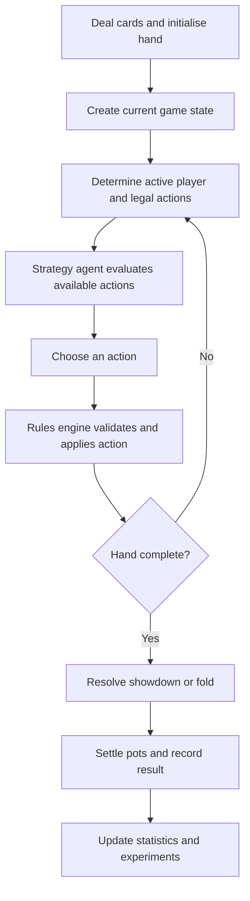
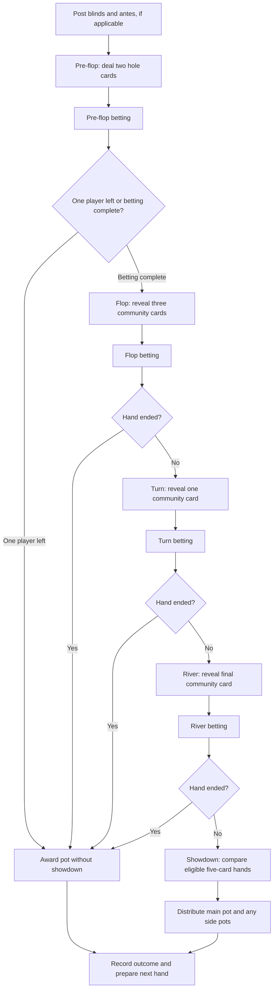
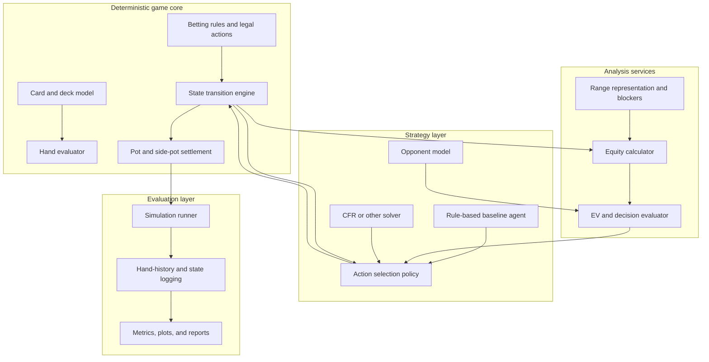
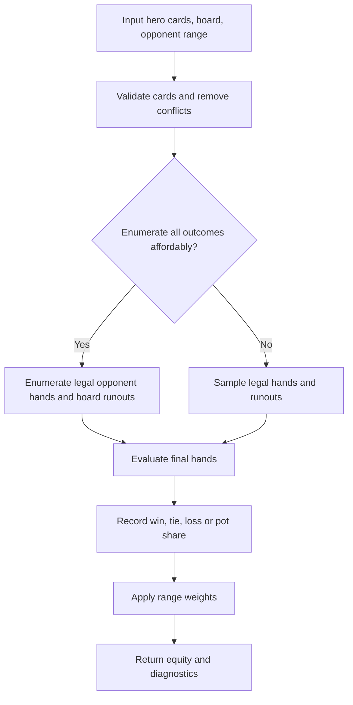
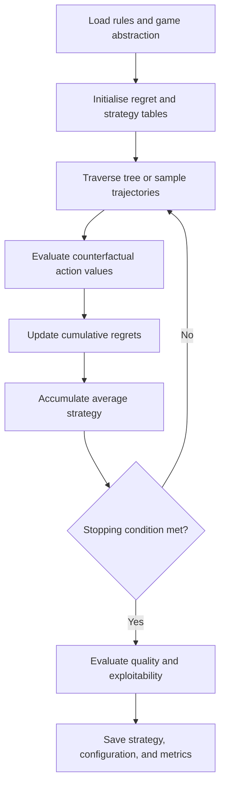
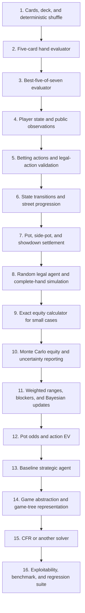

# TheEngine — Poker Computational Architecture and Implementation

> **Purpose:** A build-oriented guide to implementing a reliable No-Limit Texas Hold’em engine, from the rules core through simulation, testing, and solver integration.
>
> **Companion file:** [TheGame.md](TheGame.md) explains the probability, expected-value, strategy, and game-theory concepts used by this implementation.
>
> **Design rule:** implement a correct simulator first, an equity/EV analysis layer second, and a strategic agent or solver third.

## Contents

1. [Responsibility boundaries](#1-responsibility-boundaries)
2. [Game state and hand lifecycle](#2-game-state-and-hand-lifecycle)
3. [Cards and hand evaluation](#3-cards-and-hand-evaluation)
4. [Suggested software architecture](#4-suggested-software-architecture)
5. [Core data contracts and action APIs](#5-core-data-contracts-and-action-apis)
6. [Equity calculation and simulation implementation](#6-equity-calculation-and-simulation-implementation)
7. [Solver implementation: CFR and related methods](#7-solver-implementation-cfr-and-related-methods)
8. [Testing and mathematical invariants](#8-testing-and-mathematical-invariants)
9. [Practical learning and implementation roadmap](#9-practical-learning-and-implementation-roadmap)
10. [Configuration, logs, and experiment reproducibility](#10-configuration-logs-and-experiment-reproducibility)

---

## 1. Responsibility boundaries

A poker engine can mean several related but distinct systems. Keeping these responsibilities separate makes the project easier to test, improve, and extend.

| Component | Main question it answers | Typical output |
|---|---|---|
| **Rules engine** | What actions are legal, and what happens when one is taken? | Next game state |
| **Hand evaluator** | Which hand wins at showdown? | Hand rank and tie-break information |
| **Equity calculator** | How often does a hand or range win, tie, or lose against another hand or range? | Equity estimate |
| **Decision evaluator** | Is folding, calling, or raising profitable under the model? | Expected value (EV) for each action |
| **Strategy agent** | Which action should the player choose? | Action or action distribution |
| **Solver / trainer** | What strategy performs well against strategic opponents? | Approximate strategy and exploitability metrics |
| **Experiment layer** | Does the agent perform well over many hands and conditions? | Statistics, confidence intervals, logs, plots |

The rules engine should not decide whether a bluff is strategically good. It should only establish whether the bet is legal and apply its consequences. Strategy is a separate layer that consumes the public state, the acting player's private cards, and its model of opponents.

### A useful conceptual pipeline



The loop is important: strategy asks the rules engine what can be done; the rules engine applies the chosen action; the next state is then passed back to strategy.

---

## 2. Game state and hand lifecycle

### 2.1 Texas Hold’em hand structure

Each player receives two private **hole cards**. Up to five public **community cards** are revealed. A player's final hand is the best five-card poker hand they can make using any five of the seven available cards.



A round of betting does not necessarily require every player to take the same number of actions. A player may fold, call, check, bet, or raise depending on the current state and the game's betting rules.

### 2.2 Representing the state

A useful abstract state contains at least:

- cards dealt and community cards revealed;
- each player's hole cards, kept private from opponents;
- player stacks, contributions to the current street, and total hand contributions;
- dealer button, blind positions, and player order;
- current street (pre-flop, flop, turn, river, or terminal);
- current bet to call, minimum legal raise, and any all-in constraints;
- players still in the hand, players who have acted, and players who can still act;
- pot layers, including the main pot and side pots;
- current actor and legal actions;
- terminal outcome, if the hand is complete.

It is useful to distinguish a **full internal state** from a player's **observation**. The internal state may contain every player's cards for simulation and settlement. A player observation must not reveal an opponent's hidden cards.

### 2.3 Betting-round logic

The engine must distinguish among these actions:

- **Fold:** surrender the hand and forfeit any chips already contributed.
- **Check:** take no additional betting action when no wager must be matched.
- **Call:** match the current amount required to continue, up to the player's remaining stack.
- **Bet:** make the first wager in a betting round where no wager is outstanding.
- **Raise:** increase the amount opponents must match, subject to minimum-raise and all-in rules.
- **All-in:** commit the player's remaining stack. Depending on the amount and previous action, an all-in may be a call, a full raise, or a short raise that does not reopen betting under the applicable rules.

**Implementation warning:** betting rules have edge cases. A short all-in raise, a player who is all-in, a player who has already acted, and an incomplete final betting round can all affect which actions are legal. Encode these rules in one tested rules module rather than scattering them across strategy code.

### 2.4 Main pots and side pots

If players contribute different total amounts, they cannot all win every chip in the hand. Each pot layer is contested only by players who contributed enough to be eligible for it and did not fold.

For example, suppose three players contribute a total of 100, 200, and 300 chips respectively, and all remain eligible. The conceptual layers are:

```text
Main pot:   100 × 3 = 300 chips  -> Players A, B, and C are eligible
Side pot 1: 100 × 2 = 200 chips  -> Players B and C are eligible
Side pot 2: 100 × 1 = 100 chips  -> Player C's unmatched excess is returned
```

The precise accounting depends on the sequence of contributions and folds, but the core rule is that unmatched excess is not automatically a contested pot. A robust engine builds pot layers from contributions and eligible players, then awards each layer separately.

---

## 3. Cards and hand evaluation

The card model and hand evaluator form the foundation of the engine. Strategy should not be written until these components are reliable, because every later equity and EV result depends on correct card handling.

### 3.1 Hand categories

In standard high-hand Texas Hold’em, categories from strongest to weakest are:

1. Royal flush (a special name for the ace-high straight flush)
2. Straight flush
3. Four of a kind
4. Full house
5. Flush
6. Straight
7. Three of a kind
8. Two pair
9. One pair
10. High card

The evaluator must compare **category and tie-break information**, not merely return a label. For example, two one-pair hands must be compared by pair rank and then by kickers. The ace-low straight (A-2-3-4-5, sometimes called the wheel) must be handled explicitly.

### 3.2 A correctness-first evaluator

A simple, easy-to-audit baseline for seven-card Hold’em is to evaluate every five-card subset and retain the strongest result:

\[
inom{7}{5}=21
\]

A later optimised evaluator can instead count ranks and suits and detect straights directly. Keep the simple evaluator as a reference implementation so the optimised one can be regression-tested against it.

```python
from itertools import combinations


def best_five_of_seven(cards, evaluate_five):
    """Return the strongest 5-card result from seven cards.

    `evaluate_five` must return a comparable ranking tuple, where a larger
    tuple means a stronger poker hand. This is an interface sketch, not a
    complete card/evaluator implementation.
    """
    if len(cards) != 7:
        raise ValueError("Expected exactly seven cards")

    return max(
        evaluate_five(five_cards)
        for five_cards in combinations(cards, 5)
    )
```

The tuple returned by `evaluate_five` should encode the category first, followed by the appropriate rank and kicker values. Do not compare card names as strings; card ranks must have explicit numerical ordering.

### 3.3 Evaluator requirements

- Reject invalid card identifiers and duplicate cards.
- Support five-card evaluation and best-five-of-seven evaluation.
- Compare every hand category and category-specific tie-breakers.
- Treat suits as equal for ordinary high-hand ranking except where suit patterns determine flushes and straight flushes; suits do not break ties between otherwise identical poker hands.
- Return equal ranks for genuinely tied hands.
- Be independent of irrelevant input-card ordering.
- Include tests for wheel straights, kickers, two-pair ordering, full-house ordering, flush comparisons, and ties.

### 3.4 Suggested internal representation

Represent cards using stable values, such as integer IDs from 0 through 51, with one documented mapping from ID to rank and suit. The exact encoding is less important than uniqueness, speed, and consistency. Keep parsing/formatting (for example, `As` or `Td`) at the edges of the system rather than using strings as the internal representation.


---

## 4. Suggested software architecture

The following is a language-neutral design that can be implemented in Python first and optimised later if required.



### 4.1 Suggested module responsibilities

An example Python-oriented package structure is:

```text
poker-engine/
├── README.md
├── pyproject.toml
├── configs/
│   ├── game_rules.yaml
│   ├── simulation.yaml
│   └── strategy.yaml
├── src/
│   └── poker_engine/
│       ├── __init__.py
│       ├── cards.py             # Cards, deck, dealing, card encoding
│       ├── hand_evaluator.py    # Five-card and best-five-of-seven evaluation
│       ├── game_state.py        # State and player observations
│       ├── betting_rules.py     # Legal actions and raise constraints
│       ├── transitions.py       # Apply legal actions and advance streets
│       ├── pot_manager.py       # Contributions, main pots, side pots
│       ├── equity.py            # Exact and sampled equity
│       ├── ranges.py            # Weighted hand combinations and blockers
│       ├── expected_value.py    # Pot odds, action branches, EV calculations
│       ├── agents/
│       │   ├── random_agent.py
│       │   ├── baseline_agent.py
│       │   └── solver_agent.py
│       ├── solver/
│       │   ├── game_tree.py
│       │   ├── cfr.py
│       │   └── evaluation.py
│       └── experiments/
│           ├── simulator.py
│           └── metrics.py
└── tests/
    ├── unit/
    ├── integration/
    └── regression/
```

This is a suggested starting layout, not a mandatory one. Keep the deterministic rules and settlement code separate from agent behaviour so that multiple agents can use the same rules without changing them.

### 4.2 Keep the player observation separate from internal state

The simulation may need every hidden card to settle a hand. An agent must receive only its allowed observation. A good API makes the distinction explicit:

```python
full_state = game.get_internal_state()          # engine and settlement only
observation = game.get_observation(player_id)    # safe input for the acting agent
legal_actions = game.get_legal_actions(player_id)
action = agent.choose_action(observation, legal_actions)
new_state = game.apply_action(player_id, action)
```

These lines illustrate an interface, not a complete implementation. In a production design, prevent ordinary strategy modules from accessing `full_state` accidentally. A hidden-information leak would make agent evaluations meaningless because the agent could exploit cards it should not know.

### 4.3 Use explicit data types for money and actions

Represent chip amounts consistently—usually as integers in the smallest chip unit—rather than floats. This avoids rounding errors in contribution and side-pot calculations. Define action types explicitly, for example `Fold`, `Check`, `Call(amount)`, `Bet(amount)`, and `Raise(to_amount)`; document whether a size means “chips added” or “total wager this street.” Avoid mixing these conventions.

### 4.4 Determinism, logging, and configuration

For reproducible research, store:

- game variant and rule configuration;
- starting stacks, blinds, antes, rake, and seating;
- random seed;
- agent version or commit identifier;
- strategy parameters and action abstraction;
- hand history and terminal payoff;
- experiment size and summary metrics.

If two runs cannot be reproduced from their configuration and seed, diagnosing a strategy change becomes much harder.

---

## 5. Core data contracts and action APIs

The engine should make three operations explicit:

1. **Observation:** what the acting agent is allowed to know.
2. **Legal-action generation:** what the acting player may do now.
3. **Transition:** how a validated action changes the state.

A recommended control flow is:

```python
observation = game.get_observation(player_id)
legal_actions = game.get_legal_actions(player_id)
action = agent.choose_action(observation, legal_actions)
new_state = game.apply_action(player_id, action)
```

This is an interface sketch. It deliberately does not expose the engine's full internal state to the agent.

### 5.1 Separate full state from player observation

The internal state may contain the full deck order, all private hands, and settlement information. A player's observation must contain only the player's hole cards and information legitimately available from public action history. Use different types for these objects so accidental information leakage is harder.

```python
@dataclass(frozen=True)
class PlayerObservation:
    player_id: int
    hole_cards: tuple[int, int]
    community_cards: tuple[int, ...]
    street: str
    pot_size: int
    stack_sizes: tuple[int, ...]
    legal_action_names: tuple[str, ...]
    public_history: tuple[str, ...]
```

This is a starting shape, not a complete schema. In particular, `legal_action_names` alone is insufficient if different bet sizes are legal; a production observation should expose the actual legal action objects or a reference to them.

### 5.2 Keep chip amounts integral and unambiguous

Use integers for chips in the smallest supported unit. Define whether bet sizes mean “additional chips invested now” or “target total contribution on this street.” Never mix the two conventions.

One safe convention is:

- `Fold`, `Check`, and `Call` are action kinds whose amounts are resolved by the rules engine.
- `BetTo(amount)` means the player's total street contribution after the bet.
- `RaiseTo(amount)` means the player's total street contribution after the raise.

The transition function then calculates the incremental chips removed from the stack. All-in, short-raise, and minimum-raise rules should be handled centrally.

### 5.3 A state transition must be deterministic

Given the same full state and the same validated action, applying the action should produce the same next state. Random events such as shuffling and dealing should happen in explicitly defined chance/deal functions, not unexpectedly inside ordinary betting transitions. Deterministic transitions are easier to test, replay, and debug.


---

## 6. Equity calculation and simulation implementation

An equity calculator estimates the expected share of the pot for a hand or weighted range against another hand or range. It should share the card and hand-evaluation modules but remain separate from the betting rules.

### 6.1 Equity-calculation pipeline



### 6.2 Exact enumeration versus Monte Carlo

Use exact enumeration when the state space is small enough. Use Monte Carlo sampling when the number of legal combinations is too large. Both methods must obey card removal: no physical card can appear in more than one location, and cards known to be in players' hands or on the board cannot be sampled again.

A robust result object should include more than the final equity value:

```python
@dataclass(frozen=True)
class EquityResult:
    equity: float
    samples: int
    wins: float
    ties: float
    losses: float
    standard_error: float | None
    seed: int | None
    method: str  # "exact" or "monte_carlo"
```

For weighted or multiway pots, `wins`, `ties`, and `losses` may not be enough to describe every payout; in that case report mean pot share and any relevant distribution diagnostics as well.

### 6.3 Reproducible simulation

- Accept an explicit random seed for tests and repeatable experiments.
- Record the number of samples, method, opponent range, board, and cards.
- Check known exact cases against benchmark values.
- Report uncertainty for sampled results; a percentage without sample count is hard to interpret.
- Keep sampling uncertainty separate from uncertainty in the opponent model.

### 6.4 Performance engineering

Optimise only after correctness tests pass:

1. Profile the actual slow operation.
2. Optimise hot paths such as hand evaluation, card encoding, range enumeration, and tree traversal.
3. Retain a simple correctness baseline for cross-checking optimised code.
4. Re-run the full unit, integration, and regression suite after each optimisation.

Do not prematurely optimise the rules engine at the expense of correctness. A rare side-pot or all-in bug can bias every strategic measurement.

---

## 7. Solver implementation: CFR and related methods

The mathematical rationale for Counterfactual Regret Minimisation (CFR), regret matching, and equilibrium concepts is developed in the companion **[TheGame.md](TheGame.md)** file. This section focuses on how a solver fits into the engine.

### 7.1 Solver loop



### 7.2 Start with a tractable game

Full No-Limit Hold’em is too large for a naive tabular solver. Start with a small, precisely defined game or a restricted action tree. Practical techniques include:

- **Action abstraction:** allow a limited set of bet sizes, such as check, a small fraction of pot, a larger fraction, and all-in.
- **Chance sampling:** sample some chance outcomes rather than traversing every deal on every iteration.
- **Hand abstraction:** group strategically similar card states when justified, while recognising that abstraction loses information.
- **Function approximation:** learn representations when tabular strategies become too large; this adds training and generalisation risks.

Document the abstraction. Solver output is only a strategy for the represented game, not automatically a solution to every possible betting size in real poker.

### 7.3 Practical algorithm options

- **Vanilla CFR:** a baseline tree-traversal method.
- **Monte Carlo CFR (MCCFR):** samples parts of the game to reduce work per iteration.
- **CFR+:** modifies regret updates and often improves practical convergence.
- **Discounted CFR variants:** discount older regrets or strategy contributions in selected settings.
- **Deep CFR and related methods:** use learned function approximators when tabular representations are too large.

Choose one method only after the game tree, chance model, information sets, and payoffs are tested. Different variants have different memory, compute, and convergence behaviour.

### 7.4 Evaluate solver quality

Do not judge a solver by whether it runs or produces plausible-looking action frequencies. Track:

- iteration count and runtime;
- regret and average-strategy statistics;
- estimated exploitability or a suitable best-response metric;
- convergence stability across repeated runs;
- sensitivity to action abstraction and sampling;
- comparison with small toy games whose solutions are known;
- payoff consistency in the defined zero-sum model.

A low exploitability estimate is only meaningful relative to the chosen game representation and the reliability of the evaluation method.

---

## 8. Testing and mathematical invariants

Poker engines need tests for ordinary behaviour and for edge cases. Do not rely only on complete simulated games; rare states may be almost impossible to hit by chance.

### 8.1 Core invariants

Examples of invariants to enforce:

- A physical card appears no more than once in a dealt hand.
- A player's private cards never appear in the community board or another player's hand.
- Chips do not appear or disappear during ordinary transfers, except where the rules explicitly introduce or remove chips (for example, rake).
- No player contributes more chips than their stack permits.
- Every action returned by the legal-action function is accepted by the transition function in that state.
- Illegal actions leave the state unchanged and produce a clear error or rejection.
- A player who has folded cannot win a contested pot.
- Each pot layer is awarded only among eligible players.
- Tied best hands split the relevant pot according to the rules, including odd-chip rules if supported.
- Hand evaluation is invariant to irrelevant permutation of card order.
- Equity estimates lie between 0 and 1 and account for ties consistently.
- An agent's observation excludes other players' hidden cards.

### 8.2 Build a simple correctness baseline

Before training a sophisticated agent, build a random legal-action agent and a few deterministic test agents. The goal of these agents is not to win; it is to exercise the hand lifecycle and verify that games terminate, accounting remains correct, and logs are valid.

### 8.3 Suggested test categories

| Test layer | What to test |
|---|---|
| Unit: cards | Deck size, unique cards, dealing, card encoding |
| Unit: evaluator | Every hand category, kickers, ties, wheel straight (A-2-3-4-5), suit handling |
| Unit: betting | Check/call/fold legality, minimum raises, short all-ins, reopening rules |
| Unit: pots | Unequal contributions, folded contributions, multiple side pots, tied pots |
| Unit: probability | Exact simple draw probabilities and card-removal cases |
| Integration | Full hands across all streets, early folds, all-in runouts, showdowns |
| Information security | Observation does not leak opponent hole cards or undealt deck order |
| Regression | Saved hand histories with known correct actions and payouts |
| Strategy evaluation | Same-seed comparisons, confidence intervals, exploitability where available |

### 8.4 Useful properties for property-based testing

Instead of writing only fixed examples, generate many legal states and test properties. For example, shuffle the order of the seven cards before calling a best-five evaluator; the ranking should not change. Or generate contribution vectors and verify that settled pots sum to the total eligible contributions minus any explicitly modelled rake or returned unmatched excess.

A useful settlement identity is

\[
\text{starting chips} + \text{chips added} - \text{explicit fees}
= \text{ending chips} + \text{chips still in pots},
\]

with the exact terms adjusted to the phase represented by the test. State the accounting boundary clearly so the invariant cannot be misinterpreted.

---

## 9. Practical learning and implementation roadmap

A reliable build order is to establish correctness before strategic sophistication.



### Phase 1 — Make the game correct

Implement cards, dealing, hand evaluation, legal betting actions, state transitions, and pot settlement. Write edge-case tests before adding strategy. At the end of this phase, the engine should be able to play a complete hand and settle it correctly even when agents choose random legal actions.

### Phase 2 — Make the mathematics observable

Implement exact probability examples, an equity calculator, range weights, card removal, and EV calculations. Print intermediate quantities such as legal combinations, enumerated runouts, wins, ties, losses, and required equity. Transparent intermediate results make it easier to find modelling errors.

### Phase 3 — Build a baseline strategy

Start with a deliberately simple agent that uses position, hand strength, pot odds, and a small number of legal bet sizes. Document its assumptions. Use it to test the simulation harness and create reproducible experiments before investing in a solver.

### Phase 4 — Introduce game theory

Define the exact game tree or abstraction, represent information sets correctly, implement CFR on a tiny toy game, and verify it against a known solution before expanding the tree. Add strategy averaging, best-response evaluation, and exploitability or another suitable convergence metric.

### Phase 5 — Evaluate and improve

Compare agents over matched seeds and many hands. Report EV, variance, confidence intervals, and the game conditions. Add opponent modelling or learned approximations only after the baseline measurements are stable and reproducible.

### Implementation checklist

- [ ] Game variant and rules are written down explicitly.
- [ ] Card model prevents duplicates and handles unknown cards correctly.
- [ ] Hand evaluator handles all categories, kickers, and ties.
- [ ] Betting legality is centralised and fully tested.
- [ ] Side pots and unmatched contributions are settled correctly.
- [ ] Agent observations cannot leak private information.
- [ ] Exact equity tests agree with hand-calculated benchmark cases.
- [ ] Monte Carlo reports sample count, seed, and uncertainty.
- [ ] Range calculations respect blockers and combination weights.
- [ ] EV accounting clearly defines the decision baseline.
- [ ] Solver game abstraction and assumptions are documented.
- [ ] Solver quality is evaluated with more than visual inspection.
- [ ] Benchmarks are reproducible and include regression tests.

---

## 10. Configuration, logs, and experiment reproducibility

Store the assumptions required to reproduce a hand or experiment:

- variant and rules configuration;
- number of players, starting stacks, blinds, antes, rake, button and seating;
- random seed and shuffle/deal implementation version;
- agent version or Git commit;
- strategy parameters, allowed bet sizes, and abstraction settings;
- hand history, actions, terminal result, and chip accounting;
- simulation sample size and summary metrics.

A configuration should describe a single coherent game model. If a rule such as minimum raise, odd-chip award, rake, or all-in reopening is configurable, it must be consumed by the central rules module rather than reimplemented independently by agents.

Keep structured logs for later analysis. At minimum, record each action with the state context, actor, legal actions, chosen action, pot size, stacks, street, and random seed or hand identifier. Avoid logging private cards into player-visible histories; internal experiment logs can include hidden information only when access is restricted to the simulation/evaluation layer.

### Suggested configuration files

```text
configs/
├── game_rules.yaml       # variant, betting rules, blinds, antes, rake
├── simulation.yaml       # hands, seed, agent seats, output location
├── strategy.yaml         # baseline strategy parameters
└── solver.yaml           # abstraction, algorithm, iterations, sampling
```

Treat configuration validation as part of startup. Reject unknown variants, invalid chip values, impossible player counts, and incompatible solver settings early with a clear error message.
