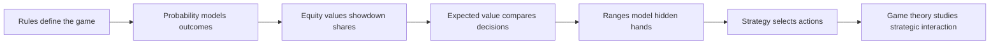
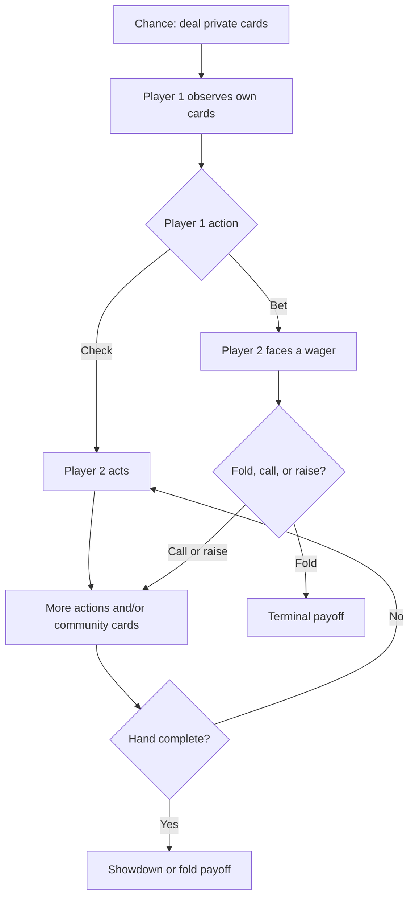
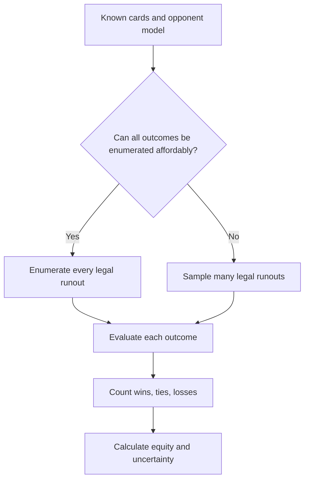
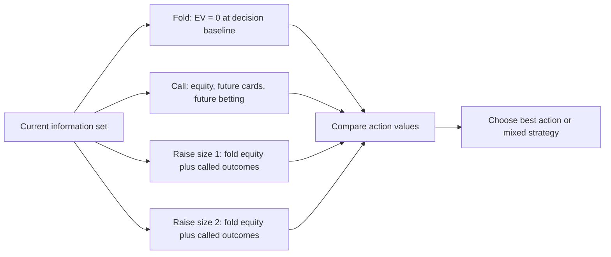
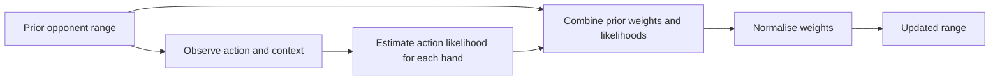
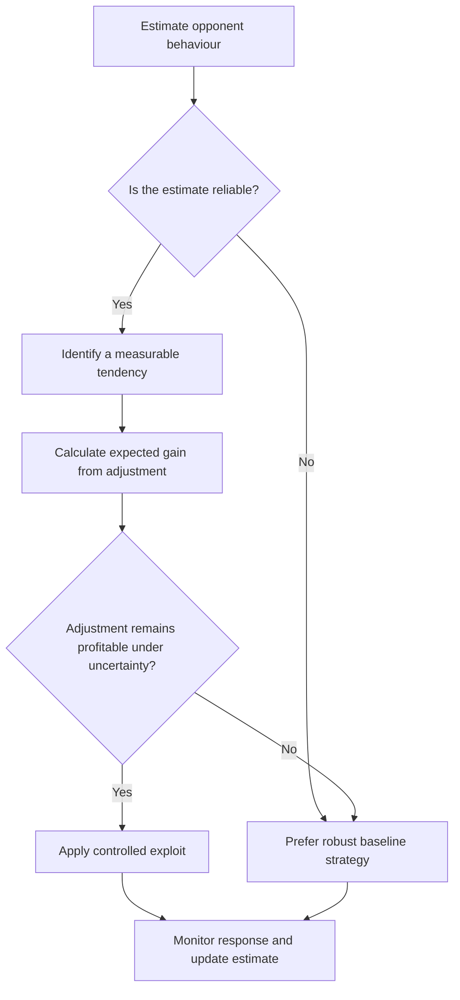
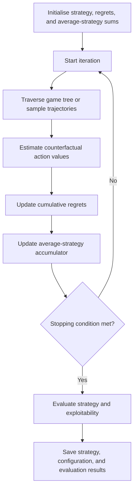

# TheGame — Poker Game Theory and Mathematics

> **Purpose:** A conceptual and mathematical reference for analysing No-Limit Texas Hold’em decisions, strategies, and solver objectives.
>
> **Companion file:** [TheEngine.md](TheEngine.md) covers the software architecture and the process of implementing a working poker engine.

## Contents

1. [Scope and mathematical viewpoint](#1-scope-and-mathematical-viewpoint)
2. [Poker as an imperfect-information game](#2-poker-as-an-imperfect-information-game)
3. [Card combinatorics and probability](#3-card-combinatorics-and-probability)
4. [Hand strength, equity, and showdown outcomes](#4-hand-strength-equity-and-showdown-outcomes)
5. [Expected value and decision analysis](#5-expected-value-and-decision-analysis)
6. [Pot odds, implied odds, and equity realisation](#6-pot-odds-implied-odds-and-equity-realisation)
7. [Ranges, combinations, and Bayesian updating](#7-ranges-combinations-and-bayesian-updating)
8. [Bet sizing, bluffs, and defence frequencies](#8-bet-sizing-bluffs-and-defence-frequencies)
9. [Strategic concepts and board analysis](#9-strategic-concepts-and-board-analysis)
10. [Game theory: Nash equilibrium and GTO](#10-game-theory-nash-equilibrium-and-gto)
11. [Solver mathematics: CFR and regret matching](#11-solver-mathematics-cfr-and-regret-matching)
12. [Monte Carlo estimation and uncertainty](#12-monte-carlo-estimation-and-uncertainty)
13. [Risk, variance, and interpreting results](#13-risk-variance-and-interpreting-results)
14. [Mathematical and strategic glossary](#14-mathematical-and-strategic-glossary)
15. [Practical rules for using the mathematics](#15-practical-rules-for-using-the-mathematics)

---

## 1. Scope and mathematical viewpoint

This guide explains **why poker decisions have the values they do**. It focuses on probability, equity, expected value, ranges, strategic incentives, equilibrium concepts, and the mathematics used to analyse a strategy. It is written for **No-Limit Texas Hold’em**; a different poker variant changes the rules and therefore changes the game being analysed.

The companion document, **[TheEngine.md](TheEngine.md)**, explains how to turn these ideas into software: state representation, legal actions, card evaluation, pot settlement, simulation, tests, and solver modules.

A useful dependency chain is:



**Important distinction:** improving a hand, winning at showdown, and making a profitable decision are three different things. A good analysis keeps them separate.

---

## 2. Poker as an imperfect-information game

### 2.1 Hidden information changes the problem

In chess, both players can inspect the current board. In poker, the public board and betting history are visible, but opponents' hole cards are hidden. A player must therefore choose actions under uncertainty.

Poker is commonly modelled as an **extensive-form game**:

- **Nodes** represent decision points or chance events.
- **Edges** represent actions, such as check, bet, call, raise, or fold.
- **Chance nodes** represent random card deals.
- **Terminal nodes** represent completed hands and their payoffs.
- **Information sets** group decision nodes that a player cannot distinguish using their own cards and the public history.



This is a simplified diagram rather than a full game tree. Real trees branch far more widely because players can choose many bet sizes and many card combinations can be dealt.

### 2.2 Information sets and strategy

A strategy cannot condition on cards the player has not seen. A strategy may condition on:

- its own hole cards;
- the public board;
- position and stacks;
- legal actions and wager sizes;
- public actions already taken;
- prior information or opponent statistics the implementation legitimately tracks.

A **pure strategy** selects one action in a decision situation. A **mixed strategy** selects actions with specified probabilities. For example, a strategy might bet a particular hand 70% of the time and check it 30% of the time in a given situation. Randomisation helps prevent an opponent from exploiting a predictable action pattern.

### 2.3 Payoffs and zero-sum models

In a simplified cash-game model without rake, chips transferred between players sum to zero: one player's gain is another player's loss. This makes the game zero-sum at the table level.

Real implementations may introduce rake, tournament payout structures, side constraints, or utility functions that make a simple chip-EV model incomplete. In tournaments, gaining 1,000 chips and losing 1,000 chips need not have symmetric effects on a player's expected prize money. Decide whether the engine optimises **chip expected value**, **cash value**, or **tournament payout equity** before interpreting results.

---

## 3. Card combinatorics and probability

Poker mathematics begins with counting possible card combinations and calculating how likely different outcomes are.

### 3.1 Counting hole-card combinations

A standard deck contains 52 cards. The number of unordered two-card starting hands is

\[
\binom{52}{2} = \frac{52\times 51}{2}=1{,}326.
\]

The familiar 169 starting-hand classes compress these 1,326 physical combinations into groups that ignore the suits' individual identities:

- **13 pocket-pair classes:** for example, AA or 77. Each pair class has \(\binom{4}{2}=6\) physical combinations.
- **78 suited non-pair classes:** for example, A♠K♠. Each suited class has 4 physical combinations.
- **78 offsuit non-pair classes:** for example, A♠K♥. Each offsuit class has 12 physical combinations.

The count checks out:

\[
13(6)+78(4)+78(12)=78+312+936=1{,}326.
\]

This matters because hand classes do not all contain the same number of physical combinations. A range containing “all AK” contains 16 combinations before card removal: 4 suited and 12 offsuit.

### 3.2 Combinations and conditional probability

The number of ways to choose \(k\) objects from \(n\) distinct objects without regard to order is

\[
\binom{n}{k}=\frac{n!}{k!(n-k)!}.
\]

Poker deals are drawn without replacement. Once a card is known, it cannot appear again in the remaining deck. Therefore, probabilities must be recalculated from the **unseen cards**, not from an imaginary deck in which every card remains available.

For example, if your two hole cards and the three flop cards are known, 47 cards remain unseen (52 − 5). If nine unseen cards complete a flush draw, the probability of hitting at least one of those nine cards across the next two cards is

\[
P(\text{hit by river})=1-\frac{38}{47}\times\frac{37}{46}\approx 34.97\%.
\]

This example assumes all nine outs are genuinely winning cards, none of them are known to be unavailable, and both turn and river are seen. In real hands, some apparent outs may complete an opponent's stronger hand, so the probability of improving is not always the same as the probability of winning.

### 3.3 The “rule of 2 and 4” approximation

A quick mental estimate often used at the table is:

- on the flop, multiply the number of outs by about 4 to estimate the chance of hitting by the river;
- on the turn, multiply the number of outs by about 2 to estimate the chance of hitting on the river.

With nine outs, this estimates roughly 36% from flop to river and 18% on the turn. The exact flop-to-river result in the example above is about 34.97%.

This is a shortcut, not a substitute for an exact calculation. It becomes less accurate with many outs, dirty outs, known dead cards, or complex multiway situations.

### 3.4 Independent-looking events may not be independent

When cards are drawn without replacement, events generally are not independent. If a card is dealt on the turn, the denominator and available cards for the river change. Similarly, the probability that an opponent holds a specific hand depends on your own cards and the public board.

Do not multiply unconditional probabilities blindly. Use conditional probabilities:

\[
P(A\cap B)=P(A)P(B\mid A).
\]

### 3.5 Exact enumeration versus simulation

Where the state space is small enough, enumerate all possible remaining board runouts. Where it is too large, estimate results by random sampling.



Enumeration gives an exact answer for the model being enumerated. Monte Carlo simulation gives an estimate whose precision improves as the number of independent samples increases.

---

## 4. Hand strength, equity, and showdown outcomes

### 4.1 Poker hand ranking

For standard high-hand Texas Hold’em, categories from strongest to weakest are:

1. Royal flush (a special name for the ace-high straight flush)
2. Straight flush
3. Four of a kind
4. Full house
5. Flush
6. Straight
7. Three of a kind
8. Two pair
9. One pair
10. High card

A correct evaluator must compare kickers and category-specific tie-breakers. For example, a pair of aces is not enough information to compare two one-pair hands; the remaining cards may determine the winner.

A seven-card evaluator can either:

- evaluate all \(\binom{7}{5}=21\) five-card subsets and choose the best; or
- use a specialised algorithm that evaluates rank counts, suit counts, straights, and tie-break values directly.

The first method is easier to validate and is often a good correctness baseline. An optimised evaluator can be introduced later and tested against the baseline.

### 4.2 Hand strength is not the same as equity

**Hand strength** often describes how strong a hand is at the current moment—for example, top pair or a flush. **Equity** describes the share of the pot a hand expects to receive at showdown against an opponent hand or range if all relevant cards are dealt and no further strategic decisions occur.

Against one specified opponent hand, showdown equity can be written as

\[
\text{Equity}=P(\text{win})+\frac{1}{2}P(\text{tie})
\]

for a two-player pot with equal splitting on a tie. In multiway pots, the equity calculation must account for the share awarded to each player and the possibility of split outcomes.

Against a range, calculate equity across the legal opponent combinations, using the specified weight for each combination and removing card-conflicting combinations. The simple unweighted version is

\[
\text{Equity}(H,R)=\frac{\sum_{h\in R}\left[W(H,h)+\tfrac12 T(H,h)\right]}{\sum_{h\in R}N(h)},
\]

where \(W\) and \(T\) stand for the number of wins and ties over the relevant runouts, and \(N(h)\) represents the number of runouts considered for opponent combination \(h\). A production implementation should use a consistent weighting and runout-counting method, especially when combinations have different weights or cards are blocked.

### 4.3 Equity is conditional on the opponent's range

A hand does not have one universal equity percentage. Its equity changes according to which hands an opponent can hold.

```text
Your hand: A♠ K♠

Against a narrow range of strong made hands:       equity may be modest
Against a range containing many weaker aces:       equity may be much higher
Against random legal hands:                        equity may be different again
```

The exact figures depend on the board and the range. The point is that an equity engine needs an opponent model; a hand evaluator alone cannot answer a strategic question.

### 4.4 Equity versus equity realisation

A player does not always get to see all five community cards. They may be forced to fold before showdown, or may use betting to make opponents fold better hands. **Equity realisation** describes how much of a hand's theoretical showdown equity is expected to translate into actual pot share under future actions.

Equity realisation depends on factors such as position, stack depth, hand playability, initiative, opponent strategy, and future betting pressure. It is not a universal constant for a hand class.

---

## 5. Expected value and decision analysis

### 5.1 What expected value means

Expected value (EV) is the probability-weighted average outcome of a decision over repeated comparable situations. It is not a promise about the next hand.

For outcomes \(x_i\) occurring with probabilities \(p_i\):

\[
EV=\sum_i p_i x_i, \qquad \sum_i p_i=1.
\]

For poker decisions, define the accounting baseline clearly. A common decision-level baseline treats chips already committed as sunk: folding has an incremental EV of zero, and calling or raising is evaluated relative to the decision point.

### 5.2 Calling a bet

Let:

- \(P\) = the pot currently available before your call, including the opponent's bet but excluding your call;
- \(C\) = the amount you must call;
- \(e\) = your equity if you call and reach showdown, assuming no future betting and ignoring rake.

If the hand always proceeds to showdown after the call, a simple approximation is

\[
EV(\text{call})=e(P+C)-C.
\]

Equivalent form:

\[
EV(\text{call})=eP-(1-e)C.
\]

The call is break-even when

\[
e_{\text{required}}=\frac{C}{P+C}.
\]

**Example:** The pot is 150 chips after an opponent bets, and it costs you 50 chips to call. The final pot after your call will be 200 chips, so the break-even equity is \(50/200=25\%\), before rake and any future betting. If your estimated equity is 30%, then

\[
EV(\text{call})=0.30(200)-50=10\text{ chips}.
\]

This is a simplified decision. On the flop or turn, a call may lead to more decisions and more bets. Use a decision tree or a more complete model if future betting is material.

### 5.3 Comparing actions

An agent can estimate the value of folding, calling, and each legal raise size, then choose the highest-value action under its objective.



A simplistic agent chooses the action with the highest estimated EV. A game-theoretic agent may deliberately mix between actions so its overall strategy is difficult to exploit, even if one action appears slightly better under a noisy estimate.

### 5.4 Value of a raise

A raise can win in two ways:

1. **Fold equity:** opponents fold and the raiser wins the existing pot without showdown.
2. **Showdown value:** opponents continue, and the raiser wins some portion of the resulting pot.

A useful conceptual decomposition is

\[
EV(\text{raise})=P(\text{fold})\,EV(\text{folds}) + P(\text{continue})\,EV(\text{called branch}),
\]

with additional branches if opponents can re-raise. The exact calculation depends on the amount invested, the existing pot, the opponent's folding and continuing ranges, and all-in or future-street outcomes.

**Do not double-count money.** When implementing EV, document whether the current pot includes the bettor's wager, whether the acting player's prior chips are treated as sunk, and whether a payout includes returning the player's own contribution. Many incorrect poker calculators are accounting errors rather than probability errors.

---

## 6. Pot odds, implied odds, and equity realisation

### 6.1 Pot odds

Pot odds compare the call amount to the total pot you can win after calling. If the pot before your call is \(P\) and the call costs \(C\), then

\[
\text{Required equity}=\frac{C}{P+C}.
\]

This is the break-even equity for a one-time call under the simplified assumptions above. Pot odds do not tell you your actual equity; they tell you how much equity you need.

### 6.2 Implied odds

**Implied odds** account for additional chips you may win on future streets when you improve. They matter when a call has insufficient immediate pot odds but can win more later.

However, implied odds are not free money. Future chips are only won if the opponent continues and pays off. The model must consider:

- how often your draw improves;
- whether the improved hand is likely to be best;
- how much the opponent can still lose;
- whether the opponent will call future bets;
- whether the draw can be dominated or produce a second-best hand.

### 6.3 Reverse implied odds

**Reverse implied odds** describe the risk of making a hand that looks strong but still loses to a stronger hand, or of paying additional bets before discovering that you are behind. A low flush draw on a paired board, for example, can have much worse practical value than its raw chance to complete suggests.

### 6.4 Stack-to-pot ratio (SPR)

The **stack-to-pot ratio** is commonly defined after the flop as

\[
SPR=\frac{\text{effective remaining stack}}{\text{pot size}}.
\]

The effective stack is the smaller amount either relevant opponent can still put into the pot. Low SPR means remaining stacks are small compared with the pot, so fewer betting decisions remain before an all-in. High SPR leaves more room for multi-street decisions, drawing hands, and large implied-odds effects.

SPR is a planning aid rather than an exact action rule. Hand strength, range composition, position, and opponent tendencies still matter.

---

## 7. Ranges, combinations, and Bayesian updating

### 7.1 What a range is

A **range** is the set of possible hands a player could hold, with a probability or weight assigned to each one. Instead of assuming an opponent has a single hand, a strategy agent usually estimates a distribution over plausible hands.

A simple range might assign weights to combinations such as:

```text
AA: 100% of available combinations
AK suited: 100%
AK offsuit: 50%
Small suited connectors: 20%
Weak offsuit hands: 0%
```

These percentages are illustrative, not universal recommendations. Real ranges depend on position, stack depth, prior actions, player pool, and the strategy being modelled.

### 7.2 Card removal and blockers

Your cards and the community cards remove combinations from an opponent's possible range. This is called **card removal**. A **blocker** is a known card that reduces the number of combinations of a particular opponent hand.

Suppose you hold an ace. There are now fewer available combinations of AA and of hands containing an ace. A blocker can therefore change both the number of value combinations an opponent can have and the number of hands that can call or fold against a bet.

A blocker is valuable strategically only in context. Holding a card that blocks strong calls may improve a bluff candidate; holding a card that blocks hands the opponent would fold can make a bluff less attractive. The effect depends on the opponent's range and the public board.

### 7.3 Bayesian updating after an action

An opponent's action provides evidence about their hidden cards. Bayes' theorem gives the basic update:

\[
P(H\mid A)=\frac{P(A\mid H)P(H)}{P(A)}.
\]

Where:

- \(H\) is a possible opponent hand or hand class;
- \(A\) is an observed action, such as raising pre-flop or betting the river;
- \(P(H)\) is the prior probability or range weight;
- \(P(A\mid H)\) is the modelled probability of taking that action with the hand;
- \(P(H\mid A)\) is the updated range weight.

For example, if a player tends to raise strong hands more frequently than weak hands, observing a raise increases the relative weight of strong hands. The size of that update depends on the assumed action frequencies.



In a solver, action probabilities come from the strategy being evaluated. In an opponent-modelling system, they may be estimated from observed data. Do not treat an action as proof of a particular hand: it changes likelihoods, it does not reveal hidden cards.

### 7.4 Weighted ranges

For a range with combination weights \(w_h\), the normalised weight of hand \(h\) is

\[
P(h)=\frac{w_h}{\sum_{g\in R}w_g},
\]

after removing hands incompatible with known cards. Equity and action EV should use these weights rather than treating all listed hands as equally likely unless uniform weighting is intended.

A useful representation stores actual card combinations—not just labels such as “AK”—because blockers operate at the physical-card level.

---

## 8. Bet sizing, bluffs, and defence frequencies

Bet size changes the risk, reward, pot odds, and range structure of a decision. The same hand can prefer a check, a small bet, or a large bet depending on the board and opponent's range.

### 8.1 Minimum fold frequency for a pure bluff

Suppose the pot is \(P\), you bluff \(B\), and you have no chance of winning when called. If the opponent folds, you win the current pot. If they call, you lose your bluff investment. Ignoring future action and rake:

\[
EV(\text{bluff})=F\,P-(1-F)B,
\]

where \(F\) is the opponent's fold probability. Setting EV to zero gives

\[
F_{\text{break-even}}=\frac{B}{P+B}.
\]

**Example:** bluffing 75 chips into a 100-chip pot requires folds more than \(75/(100+75)=42.86\%\) of the time to be profitable as a pure bluff.

This is not a universal recommendation to bluff at that frequency. It is a break-even threshold under a simplified model. A bluff with equity when called can require fewer folds; a bluff that sacrifices future EV can require more.

### 8.2 Minimum defence frequency (MDF)

In a simplified one-street model, the **minimum defence frequency** is often written as

\[
MDF=\frac{P}{P+B},
\]

where \(P\) is the pot before the opponent's bet and \(B\) is the bet size. It describes how often a defender would need to continue in an idealised setting to prevent a zero-equity bluff from automatically profiting by betting any two cards.

Examples:

| Bet size | Simplified MDF |
|---|---:|
| 25% pot | 80% |
| 50% pot | 66.7% |
| 75% pot | 57.1% |
| 100% pot | 50% |
| 150% pot | 40% |

MDF is a theoretical reference, not a command to call with a fixed share of every range. Real strategies fold more or less depending on equity, future streets, range composition, multiway action, and whether the bettor has value hands and bluffs in appropriate proportions.

### 8.3 Bluff-to-value ratio at the river

Consider a simplified river bet of size \(B\) into a pot \(P\), with hands that always win when called as value bets and hands that always lose when called as bluffs. To make a bluff-catcher indifferent between calling and folding, the fraction of bluffs among the bettor's betting range is

\[
\text{Bluff fraction} = \frac{B}{P+2B}.
\]

Equivalently, the bluff-to-value ratio is

\[
\frac{\text{Bluffs}}{\text{Value bets}}=\frac{B}{P+B}.
\]

For a pot-sized bet (\(B=P\)), this simplified model implies one bluff for every two value bets; bluffs comprise one-third of the betting range. These are idealised river equations, not automatic ratios for flop and turn betting, where hands have equity and future decisions remain.

### 8.4 Why multiple bet sizes matter

A small bet may be useful when a player has a broad range advantage and wants weaker hands to continue. A large bet may be useful when the bettor has more very strong hands and wants to apply pressure to a capped range. These are common strategic patterns, not laws.

A solver must make bet sizes explicit. If the engine allows every possible real-valued bet amount, the decision tree becomes enormous. Practical solvers often use a carefully selected **action abstraction**, such as a few fractions of the pot plus all-in. An abstraction improves tractability but can also exclude strategically important actions.

---

## 9. Strategic concepts and board analysis

### 9.1 Position

Position describes the order in which a player acts. A player who acts later in a betting round generally has more information about the actions others have taken before making a decision. Acting last after the flop is often called being **in position**.

Position affects:

- how much information is available before acting;
- the ability to control pot size;
- the ability to realise equity;
- the profitability of marginal calls and bluffs;
- the range of hands that can be played profitably.

The dealer button is last to act on the flop, turn, and river in standard heads-up and multiway Hold’em betting order, subject to players remaining in the hand. Pre-flop order differs because of the blinds.

### 9.2 Range advantage and nut advantage

- **Range advantage:** one player's overall range has higher average equity against the opponent's range on a particular board.
- **Nut advantage:** one player's range contains more of the strongest possible hands on that board.

A player can have range advantage without holding the absolute strongest hands very often. Nut advantage is especially relevant to large bets and overbets because a strong concentration of near-maximum hands can support a polarised strategy.

### 9.3 Board texture

Board texture describes features of the community cards that affect hand possibilities:

- **Dry board:** few obvious draws and limited interaction among ranks and suits.
- **Wet board:** many possible draws or changing turn and river cards.
- **Paired board:** at least two community cards share a rank.
- **Monotone board:** all three flop cards share a suit.
- **Connected board:** ranks are close together, creating straight possibilities.
- **High-card board:** includes high ranks such as ace, king, or queen, which may favour certain pre-flop ranges.

These labels summarise structure; they do not determine the correct action in isolation. The engine should represent actual cards and compute the range/equity consequences rather than relying only on labels.

### 9.4 Continuation bets

A **continuation bet** (c-bet) is a bet made by the pre-flop aggressor on a later street after having raised before the flop. The aggressor may retain a range advantage on some boards, but not all boards favour the aggressor.

Decision factors include board texture, number of opponents, position, effective stacks, range advantage, nut advantage, and what the opponent's prior call tends to represent. C-betting too frequently can expose the player to check-raises; c-betting too rarely may miss profitable value bets and bluffs.

### 9.5 Value betting and thin value

A **value bet** aims to be called by enough worse hands to make the bet profitable. A **thin value bet** targets a narrower set of worse hands and accepts more difficult calls. The decision depends on the opponent's calling range, not merely on whether your hand looks strong.

### 9.6 Bluffing and semi-bluffing

A **bluff** seeks folds from better hands. A **semi-bluff** is a bet or raise with a hand that can improve to a strong hand if called, such as a flush draw. Semi-bluffs can win immediately through folds and can also win at showdown when they improve.

Strong bluff candidates often—but not always—have useful blockers, retain equity when called, and block some of the opponent's strongest continuing hands while leaving weaker folds unblocked. Strategy needs to calculate these features from actual cards and ranges.

### 9.7 Bluff-catchers

A **bluff-catcher** is a hand that is typically ahead of an opponent's bluffs but behind their value bets. Its call decision depends on the ratio of bluffs to value hands in the opponent's range and on the price offered by the pot.

A hand is not a good bluff-catcher simply because it beats some plausible hands. It must beat enough of the betting range to justify the call.

### 9.8 Slow-playing, checking, and protection

- **Slow-playing:** taking a passive action with a strong hand to allow opponents to bluff or improve, while risking free cards or missed value.
- **Checking:** can control pot size, induce bluffs, protect a checking range, or avoid an unprofitable bet.
- **Protection:** betting to charge hands with meaningful chances to improve, even where immediate value is not the only reason for betting.

These concepts can overlap. The correct choice depends on the expected actions and outcomes of later streets, not just the current hand category.

---

## 10. Game theory: Nash equilibrium and GTO

### 10.1 Nash equilibrium

A **Nash equilibrium** is a strategy profile in which no player can improve their expected payoff by changing strategy alone while the other players keep their strategies fixed.

In two-player zero-sum poker models, an equilibrium strategy provides a robust benchmark: against a best-response opponent, neither player can gain by unilaterally changing strategy away from equilibrium. In practical poker language, **game-theory-optimal (GTO)** usually refers to a strategy designed to approximate such an equilibrium for a defined game model.

Important qualifications:

- An equilibrium is relative to the exact rules, stack sizes, rake model, allowed bet sizes, and game abstraction.
- A strategy solved for one scenario is not automatically optimal for a different scenario.
- A near-equilibrium strategy is not necessarily the most profitable response to a weak or highly predictable opponent.
- A finite, simplified action tree can make solving possible while excluding strategies that exist in the full game.

### 10.2 Balanced versus exploitative play

**Balanced / equilibrium-oriented play** aims to avoid systematic weaknesses that opponents can exploit. It often uses mixed strategies and balances value bets with bluffs in relevant situations.

**Exploitative play** deliberately adjusts to an opponent's weaknesses. For example, if an opponent folds too often to large river bets, bluffing more may be profitable. If an opponent calls too often, reducing bluffs and value betting more can be profitable.



Exploitation has a trade-off: it can gain more against a specific error, but it can lose value if the read is wrong or the opponent adapts. A robust engine should make the objective configurable and track uncertainty in opponent estimates.

### 10.3 Why randomisation matters

Suppose a player bluffs every time with a particular missed draw and always bets their strong hands. A perceptive opponent can infer what the action means and adjust. Mixing actions with overlapping hand classes makes the player's range less transparent.

Randomisation should be reproducible in testing. Use a seeded random-number generator when a test needs the same sequence every time. In live simulation, draw according to the chosen action probabilities and record enough information to reproduce the experiment.

### 10.4 No single “GTO chart” solves all poker

A strategy depends on the game's assumptions: heads-up or multiway, tournament or cash game, stack depth, rake, position, action history, bet sizes, and more. Pre-flop charts and post-flop solver outputs are conditional references, not timeless universal rules.

A realistic solver project should clearly state the exact game it approximates and the abstraction it uses. Otherwise “optimal” is too vague to be a testable claim.

---

## 11. Solver mathematics: CFR and regret matching

### 11.1 Why solving poker is difficult

The number of possible deals and action histories grows rapidly. Hidden cards mean that decisions made at different hidden states can belong to the same information set. A solver must account for both chance and the fact that players cannot distinguish every internal state.

A brute-force strategy search over every possible bet amount and every hand history is usually too large. Practical solvers reduce the problem using limited bet sizes, sampled outcomes, hand abstraction, or function approximation.

### 11.2 Counterfactual Regret Minimisation (CFR)

**Counterfactual Regret Minimisation (CFR)** is a family of algorithms widely used to approximate equilibrium strategies in extensive-form games with imperfect information.

Intuition:

1. Visit decision information sets while considering outcomes under the current strategy.
2. Compare the value of the action actually selected by the current strategy with the value that would have resulted from choosing each available action instead, holding the relevant counterfactual context fixed.
3. Accumulate positive regret for actions that would have performed better.
4. Increase the probability of actions with greater positive cumulative regret.
5. Repeat many iterations and use the average strategy rather than assuming the last iteration is the final answer.

A simplified regret-matching update for action \(a\) at information set \(I\) can be written as

\[
\sigma_{t+1}(I,a)=
\begin{cases}
\dfrac{R_t^+(I,a)}{\sum_{a'}R_t^+(I,a')} & \text{if the denominator is positive},\\[6pt]
\dfrac{1}{|A(I)|} & \text{otherwise},
\end{cases}
\]

where \(R_t^+(I,a)=\max(R_t(I,a),0)\), \(R_t\) is cumulative regret, and \(A(I)\) is the legal action set at information set \(I\). This is a conceptual update; practical CFR implementations use carefully defined counterfactual values, reach probabilities, averaging rules, and traversal conventions.

### 11.3 CFR loop (conceptual)



### 11.4 Common variants

- **Vanilla CFR:** traverses the game tree and updates regrets using counterfactual values.
- **Monte Carlo CFR (MCCFR):** samples parts of the game to reduce the cost per iteration.
- **CFR+:** uses a regret update with truncation of negative cumulative regrets and related improvements that can accelerate convergence in many settings.
- **Discounted CFR variants:** discount older regret and/or strategy contributions to improve practical convergence in some games.
- **Deep CFR and related function-approximation methods:** use learned models to represent strategy or value information where tabular representations become too large.

These methods have different memory, compute, and convergence characteristics. Start with a small, well-tested game before attempting a large no-limit Hold’em abstraction.

### 11.5 Exploitability and convergence checks

A solver should not be judged only by whether it runs or produces plausible-looking action frequencies. Useful checks include:

- regret trends and iteration counts;
- approximate exploitability or a suitable best-response metric;
- convergence stability across repeated runs;
- sensitivity to the action abstraction and sampling settings;
- comparisons against known toy games with computable equilibria;
- consistency of expected payoffs in zero-sum settings.

A low exploitability estimate is meaningful only relative to the chosen game representation and the accuracy of the evaluation method.

---

## 12. Monte Carlo estimation and uncertainty

### Monte Carlo equity calculation

When exhaustive enumeration is too expensive, sample random legal runouts and evaluate the final hands. For each sample, record the hero's payoff as 1 for a win, 0.5 for a heads-up tie, and 0 for a loss. The mean estimates equity under the sampling assumptions.

If \(X_i\) is the equity payoff for sample \(i\), then

\[
\hat p=\frac{1}{N}\sum_{i=1}^{N}X_i.
\]

For a simple independent Bernoulli win/loss estimator, the approximate standard error is

\[
SE(\hat p)\approx\sqrt{\frac{\hat p(1-\hat p)}{N}}.
\]

Poker equity samples may include half-point ties or multiway shares, so this Bernoulli formula is only an approximation in those cases. A more general estimate uses the sample variance:

\[
SE(\hat p)=\frac{s_X}{\sqrt N}.
\]

The approximate standard error shrinks at a rate proportional to \(1/\sqrt{N}\). To halve the standard error, roughly four times as many samples are needed.

### Confidence intervals and practical reporting

A simulation should report more than a percentage. Include:

- number of samples or enumerated outcomes;
- random seed and sampling method;
- hero hand and board;
- opponent hand or range definition;
- whether ties are split and how multiway pots are handled;
- estimated equity and an uncertainty measure;
- whether rake, future actions, or card-removal constraints are included.

A narrow confidence interval does not fix a poor opponent-range model. Sampling uncertainty and modelling uncertainty are different problems.

### Exact versus approximate calculators

| Method | Strength | Limitation |
|---|---|---|
| Exact enumeration | Deterministic, exact for the stated finite model | Can be too slow for large state spaces |
| Monte Carlo sampling | Handles large spaces flexibly | Has sampling error and needs reproducible randomisation |
| Analytical formula | Fast and transparent when assumptions fit | Many realistic poker situations are too complex for a short closed-form formula |
| Learned approximation | Can provide fast decisions after training | Requires data or training, careful validation, and monitoring for generalisation failure |

---

## 13. Risk, variance, and interpreting results

### 13.1 Positive EV does not guarantee a short-term win

Poker outcomes vary. A profitable decision can lose on the next hand, and an unprofitable decision can win occasionally. **Variance** measures the spread of outcomes around the mean; it is separate from whether a strategy has positive expected value.

A test over a small number of hands can be dominated by chance. Use many independent or appropriately blocked trials and report uncertainty rather than concluding that one strategy is superior from a short run.

### 13.2 Win rate, EV, and sample size

A strategy evaluation should distinguish:

- chips won or lost in the observed sample;
- estimated EV per hand or per decision;
- win rate under the experiment's units and blind structure;
- standard error or confidence interval;
- opponent population and table conditions;
- rake and other costs;
- number of hands or decision situations sampled.

Comparisons are fair only when strategies face comparable deals, opponents, positions, stack depths, and rules. **Duplicate or paired testing**—running competing agents through the same deals and seats where feasible—can reduce noise in comparisons.

### 13.3 Chip EV versus tournament equity

In a cash-game-style model, chips are often treated as linear utility. In a tournament, chip stacks determine probabilities of finishing in different payout positions, and payouts are not usually linear in chips. A tournament engine may need an independent-chip-model approximation or a more detailed payout-equity calculation. This is a separate layer from evaluating which poker hand wins the pot.

---

## 14. Mathematical and strategic glossary

| Term | Meaning |
|---|---|
| **Action abstraction** | A restricted set of available bet sizes/actions used to make a game tree computationally manageable. |
| **All-in** | A player commits their remaining stack. |
| **Bayesian updating** | Revising the relative probability of possible hands after observing evidence, such as an action. |
| **Blocker** | A known card that reduces the possible combinations of an opponent's hand. |
| **Bluff-catcher** | A hand that tends to beat bluffs but lose to value bets. |
| **C-bet** | A continuation bet made by the pre-flop aggressor on a later street. |
| **CFR** | Counterfactual Regret Minimisation, a family of algorithms for approximating equilibrium strategies. |
| **Combo / combination** | A specific physical selection of cards; often used when counting hand possibilities. |
| **Equity** | A hand or range's expected share of the pot at showdown under a defined deal model. |
| **Equity realisation** | The degree to which theoretical showdown equity translates into actual pot share after strategic actions. |
| **Expected value (EV)** | Probability-weighted average outcome of a decision. |
| **Exploitability** | How much an opponent using a best response can gain from a strategy relative to the relevant equilibrium benchmark. |
| **Fold equity** | The value gained from the probability that an opponent folds to a bet or raise. |
| **GTO** | Game-theory-optimal; in practice, usually a strategy approximating equilibrium for a defined game model. |
| **Information set** | Decision situations a player cannot distinguish from the information available to them. |
| **Implied odds** | Potential future winnings that may be earned when a draw improves. |
| **MDF** | Minimum defence frequency, a theoretical reference for how often to continue against a bet in a simplified model. |
| **Monte Carlo** | Estimating a quantity through random sampling. |
| **Nash equilibrium** | A strategy profile where no player benefits by changing strategy alone while others' strategies remain fixed. |
| **Nut advantage** | Relative advantage in holding the strongest possible hands on a given board. |
| **Out** | An unseen card that improves a hand, ideally to a winner; some apparent outs are “dirty” because they do not guarantee winning. |
| **Pot odds** | The price of a call relative to the pot available after calling. |
| **Range** | A weighted set of possible hands a player can hold. |
| **Regret matching** | A method that assigns more strategy probability to actions with greater positive cumulative regret. |
| **Reverse implied odds** | Potential future losses caused by making a second-best hand or paying off a stronger one. |
| **SPR** | Stack-to-pot ratio: effective remaining stack divided by pot size. |
| **Variance** | A measure of how widely outcomes spread around their expected value. |
| **Value bet** | A bet intended to be called by enough worse hands to be profitable. |

---

## 15. Practical rules for using the mathematics

1. **State the assumptions.** Specify known cards, opponent range, bet size, future-street assumptions, rake, and whether the calculation is heads-up or multiway.
2. **Separate model error from sampling error.** A Monte Carlo estimate may be statistically precise while the opponent-range assumptions are wrong.
3. **Use chip EV carefully.** Cash-game chip EV and tournament prize equity are not interchangeable objectives.
4. **Do not treat heuristics as laws.** MDF, the rule of 2 and 4, and simplified bluff/value ratios are reference calculations whose assumptions may not hold in a real multi-street hand.
5. **A strategy is conditional on a game model.** Stack size, allowed bet sizes, rake, opponent count, position, and tournament payout rules all change the problem.

The computational implementation should expose key intermediate quantities—combination counts, equity, pot odds, EV branches, sampling settings, and uncertainty—so mathematical mistakes can be diagnosed rather than hidden behind one final percentage.
